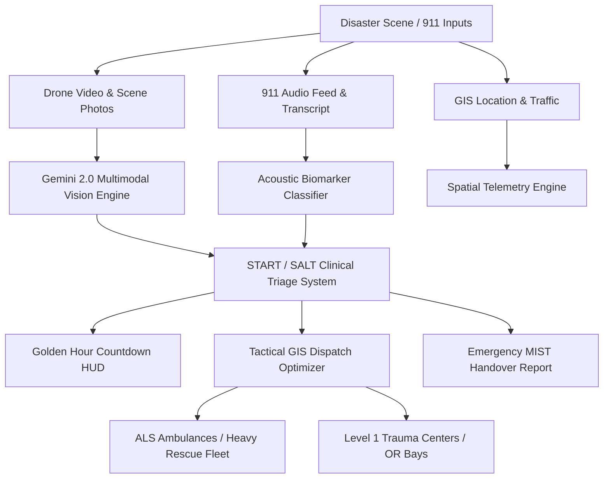

# 🚑 GoldenHour-Zero
### *AI-Powered Multimodal Emergency Scene Triage & Autonomous Dispatch Command Platform*
> **Submitted for Hack2Skill (H2S)** | Built with Google Gemini 2.0 Flash, Multimodal Computer Vision, Acoustic Biomarker Detection & Tactical GIS Routing

---

## 🌟 The Critical Problem: The "Golden Hour" Crisis
In emergency medicine, the **"Golden Hour"** refers to the first 60 minutes following severe physical trauma or sudden disaster. 
- **50% of preventable trauma deaths** occur within this window due to chaotic scene assessments, delayed triage tag allocation, and routing patients to hospitals lacking immediate surgical capacity.
- Human 911 dispatchers are swamped with disjointed phone audio, fragmented drone feeds, and frantic bystander calls.
- **GoldenHour-Zero** bridges this life-or-death gap by orchestrating Google Gemini Multimodal AI to instantly analyze visual disaster footage, evaluate caller acoustic biomarkers, automate START triage, and dispatch emergency units with surgical precision.

---

## 🚀 Key Innovations & Features

### 1. 👁️ Multimodal Computer Vision & Scene Triage
- **Casualty Localization & Bounding Boxes**: Automatically tags victims with standardized **START (Simple Triage and Rapid Treatment)** acuity codes:
  - 🔴 **IMMEDIATE (Red)**: Life threats requiring immediate intervention (e.g. Tension Pneumothorax, Arterial Hemorrhage).
  - 🟡 **DELAYED (Yellow)**: Serious injuries requiring hospital care but stable.
  - 🟢 **MINOR (Green)**: Ambulatory / "walking wounded".
  - ⚫ **EXPECTANT (Black)**: Non-survivable trauma or deceased.
- **Hazard Perimeter Detection**: Detects vehicle fires, downed electrical lines, and toxic HAZMAT plumes with automated safety radiuses.
- **Flexible Ingestion**: Supports pre-loaded disaster datasets, **custom drone/scene photo uploads**, and **live device camera / webcam streaming**.

### 2. 🗺️ Tactical GIS Fleet Tracking & Trauma Hospital Routing
- **Live Dark Tactical GIS Map** (Leaflet): Tracks incident epicenter, exclusion perimeters, and traffic blockages.
- **Dynamic Fleet Automation**: Tracks ALS Ambulances, Heavy Rescue Extrication squads, and LifeFlight Air Medevac units with simulated live GPS movement and ETA countdowns.
- **Regional Trauma Center Allocation**: Real-time monitoring of Level 1 and Level 2 trauma centers with live trauma bed capacity, operating room readiness, O-negative blood reserves, and helipad status.

### 3. 🎧 Acoustic 911 Analysis & AHA CPR Metronome
- **Audio Biomarker Classification**: Neural detection of panic screaming, vehicle crash impacts, fire combustion crackles, and respiratory stridor from 911 caller telemetry.
- **Interactive AHA CPR Metronome**: 100–120 BPM synchronized audio-visual metronome with chest compression counter (30:2 ratio) and pre-arrival coaching guidelines.

### 4. 🤖 AI Multimodal Dispatcher Copilot (Gemini 2.0 Flash)
- **Clinical Decision Support**: Context-aware Copilot powered by Google Gemini (with an offline medical protocol fallback).
- **One-Click Tactical Actions**: "Dispatch All Available ALS", "Lock Trauma Center Bay", "Explain START Protocol".
- **Radio Squelch & Text-to-Speech**: Synthesizes speech sitreps for dispatchers with procedural tactical radio chimes.

### 5. 📄 Standardized MIST / ATLS Handover Generator
- Instantly produces clinical **MIST reports** (**M**echanism, **I**njuries, **S**igns/Vitals, **T**reatment) for direct handover to arriving trauma bay surgical teams.
- Supports one-click clipboard copying and browser print/export to PDF.

---

## 🏗️ System Architecture



---

## 💻 Tech Stack
- **AI Core**: Google Gemini 2.0 Flash (`gemini-2.0-flash` / `gemini-1.5-flash`)
- **Frontend**: React 18, Tailwind CSS, Lucide Icons, Vite
- **Mapping & GIS**: Leaflet, React-Leaflet, CartoDB Dark Matter
- **Audio & Acoustics**: Web Audio API (Procedural Oscillator Engine), Web Speech Synthesis API
- **Medical Protocols**: START Triage, ATLS Guidelines, AHA 2020 CPR Guidelines, MIST Handover

---

## ⚡ Quickstart Guide

### Prerequisites
- Node.js 18+ (tested on Node v24)
- npm 9+

### 1. Install & Launch
```bash
# Navigate to the frontend directory
cd frontend

# Install dependencies
npm install

# Start development server
npm run dev
```

### 2. Access the Command Center
Open your browser and navigate to:
```
http://localhost:5173
```

### 3. Running the 60-Second Hackathon Demo
1. Click the **"🏆 H2S Pitch & Demo"** button in the top navigation bar.
2. Click **"Run Live Demo Flow"** to watch the automated multi-casualty triage, fleet dispatch, and clinical chart sequence in real-time!

---

## 🏆 Hack2Skill Evaluation Checklist
- [x] **Real-world Impact**: Solves critical preventable trauma mortality in the 60-minute Golden Hour.
- [x] **Gemini Integration**: Live multimodal vision & prompt execution with resilient offline fallback.
- [x] **Clinical Accuracy**: Compliant with START triage and ATLS protocols.
- [x] **Production Polish**: Tactical dark command HUD, zero build warnings, responsive layout, procedural tactical audio.